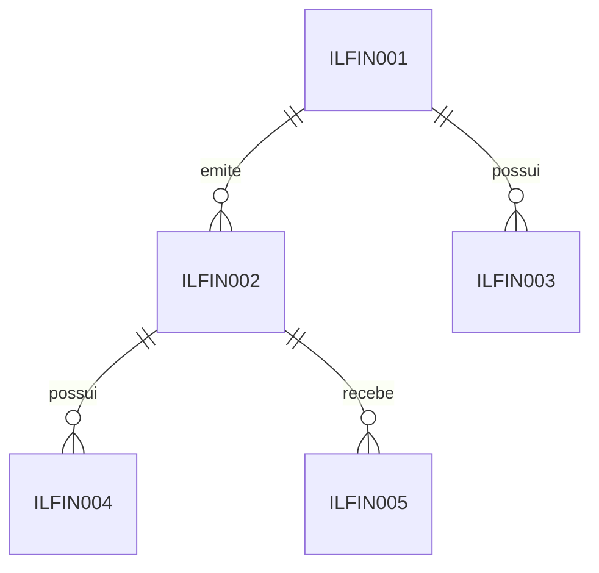

# Modelagem financeira — Etapa 3

## Fundamentação

Foram lidos `docs/database-rules.md`, `docs/api-rules.md` e
`docs/bolsai-integration.md`, além do cliente e dos testes da Etapa 2.

| Situação | Dados |
| --- | --- |
| Confirmado por documentação | identificação da companhia (nome, razão social, setor e ticker primário); cotação (`close`, `trade_date`); P/L, Dividend Yield, ROE, dívida/patrimônio, margem líquida e `reference_date`. |
| Confirmado por resposta simulada de teste | os mesmos campos acima, com DY, ROE e margem em percentual humano; `null` é preservado. |
| Não confirmado por resposta real | disponibilidade para a chave em uso, unidades observadas e campos de proventos. |

Não houve resposta de produção armazenada no repositório. Logo, esta modelagem não
assume CNPJ, segmento, situação, moeda, tipo de ativo, nem datas completas de
proventos.

## Objetos

| Tabela | Finalidade | Chave e integridade |
| --- | --- | --- |
| `ILFIN001` | Empresa emissora. | `ID_Empresa` é PK. Nome, razão social e setor são anuláveis; `NM_Fonte` preserva a origem. |
| `ILFIN002` | Ativo negociado. | PK `ID_Ativo`; FK obrigatória para empresa; `UK_ILFIN002_CD_Ticker`; ticker binário, sem espaços e em maiúsculas; índice por empresa. |
| `ILFIN003` | Snapshots de ROE, dívida/patrimônio e margem líquida da empresa. | FK para empresa; ao menos um indicador; unicidade filtrada por empresa, fonte e data de referência quando a fonte fornece a data. |
| `ILFIN004` | Snapshots de P/L e Dividend Yield do ativo. | FK para ativo; ao menos um indicador; unicidade filtrada por ativo, fonte e data de referência quando disponível. |
| `ILFIN005` | Cotações de fechamento datadas. | FK para ativo; unicidade filtrada por ativo, fonte e data de referência quando disponível. |

Todas as novas tabelas têm registro idempotente em `ILCAD000`.

## Unidades, datas e histórico

Os valores que podem requerer precisão usam `DECIMAL(18,8)`, não `FLOAT` ou
`REAL`. `PE_DividendYield`, `PE_ROE` e `PE_MargemLiquida` guardam percentual
humano, sem conversão: `6.00000000` representa 6%. `VL_PL` e
`VL_DividaPatrimonio` são múltiplos/razões, não percentuais. Preço de fechamento
é `VL_PrecoFechamento`; a fonte não confirmou moeda, portanto não há coluna de
moeda artificial.

`DT_Referencia` é a data publicada pela fonte (`reference_date` ou
`trade_date`) e permanece nula se não vier no contrato. `DH_Coleta` é a data/hora
de obtenção e não substitui a data de referência. Cada tabela de snapshot mantém
histórico. Para datas de referência disponíveis, a chave lógica é entidade +
fonte + data e a Etapa 4 deverá atualizar essa linha, sem duplicação. Sem data
de referência não há chave lógica confiável: a Etapa 4 deverá registrar a coleta
somente com política explícita, sem inventar uma data de mercado.

`ILFIN003` fica no nível da empresa porque ROE, dívida/patrimônio e margem são
relações contábeis. `ILFIN004` fica no ativo porque P/L e DY podem variar com a
cotação. Isso evita repetir indicadores contábeis para PETR3 e PETR4.

## Identificação e rastreabilidade

O ticker não identifica a empresa: identifica unicamente o ativo. A empresa tem
chave interna e pode ter vários ativos. Os campos atualmente confirmados não
trazem CNPJ nem identificador corporativo estável; por isso não foi criada uma
UNIQUE especulativa para empresa. A Etapa 4 deverá definir, com dados reais,
como associar um novo ticker a uma empresa já existente (por exemplo, mediante um
identificador corporativo confirmado). `NM_Fonte` registra a origem textual de
cada cadastro e observação, permitindo fontes futuras sem acoplamento físico à
bolsai.

## Cotações e proventos

`ILFIN005` é histórico de cotações somente quando `trade_date` é entregue; não
fabrica pregões a partir de `DH_Coleta`. A cotação mais recente é uma consulta,
não um atributo universal do ativo.

Não foi criada tabela de dividendos/JCP. Embora o endpoint esteja documentado,
a própria Etapa 2 indica que ele pode depender do plano e que não há confirmação
por resposta real para a chave usada. A futura modelagem deverá confirmar tipo,
valor por ação, data-com, pagamento e a chave de deduplicação antes de persistir
proventos. O cálculo de preço máximo também não é armazenado: depende da
configuração individual de retorno desejado.

## Execução e pendências

Os blocos foram adicionados a `dbObjects/tables/001_CreateTables.sql` e são
reexecutáveis em bancos que ainda não possuem as novas tabelas; a remoção local
correspondente está em `002_DropTables.sql`, na ordem de dependências. Execute
`001_CreateTables.sql` com uma ferramenta compatível com `GO`, após backup e em
ambiente de desenvolvimento autorizado. Não há conexão de banco configurada neste
trabalho, portanto a execução contra SQL Server permanece pendente.

Na Etapa 4, `CD_TickerPrimario` passou a preservar o `ticker_primary` da fonte e
serve para reunir ativos da mesma empresa sem deduplicação por nomes. A persistência
manual e sua política de atualização estão em [financial-import.md](financial-import.md).
